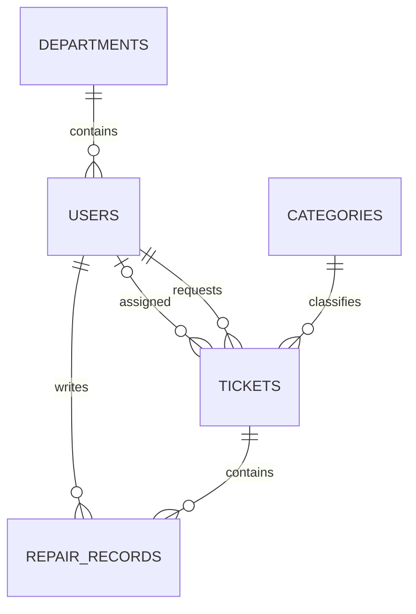

# IT 資訊報修管理系統 — 系統設計書

版本：1.1｜2026-11-16｜對應 SPEC.md v1.1

## 1. 技術規格

| 項目 | 技術 |
|---|---|
| 語言 | Java 21 |
| 後端 | Spring Boot 3.5.14、Spring MVC |
| 建置 | 相容的 Maven 3.9.x、Maven Wrapper |
| View | Thymeleaf（SSR）、HTML、CSS、JavaScript、Bootstrap |
| 資料庫 | SQLite（本機 data/helpdesk.db） |
| 持久化 | Spring Data JPA、Hibernate、SQLite JDBC、Hibernate SQLite community dialect |
| 認證 | Spring Security、HTTP Session、BCrypt |
| 驗證與測試 | Jakarta Validation、JUnit、Spring Boot Test、Spring Security Test |
| 版本控制 | Git |

pom.xml 必須使用 org.springframework.boot:spring-boot-starter-parent:3.5.14，java.version 設為 21。不得自行升級 Spring Boot。由 Maven 依照 Parent 的 dependency management 解析 spring-boot-starter-web、spring-boot-starter-thymeleaf、spring-boot-starter-data-jpa、spring-boot-starter-security、spring-boot-starter-validation、spring-boot-starter-test 及其他受管理依賴，這些依賴不另填 version。只有未受管理的依賴才明確選定並固定相容版本，例如 SQLite JDBC 若未受管理；hibernate-community-dialects 必須與實際解析的 hibernate-core 同版，若 Parent 已管理則不另填版本。使用 Maven Wrapper 固定相容 Maven 3.9.x 版本，Phase 1 確認並記錄實際版本。透過 Maven effective-pom、dependency:tree、編譯與測試檢查相容性，不任意覆寫受管理版本。不得使用 Lombok。

## 2. 架構

Browser → Spring Security → Controller → Service → Repository → SQLite。
Controller 使用 Model 將資料交給 Thymeleaf View，再回傳 HTML。

- Controller：HTTP 請求、表單 BindingResult、頁面導向；不得直接存取 Repository。
- Service：授權、業務規則、狀態轉換、交易管理。
- Repository：JpaRepository、分頁與搜尋。
- Entity：資料表映射；DTO：表單與展示資料；Enum：固定角色與狀態。
- Config：安全設定及資料庫組態；Exception：一致的錯誤處理。

## 3. 專案目錄

```text
it-helpdesk-system/
  SPEC.md
  DESIGN.md
  AGENTS.md
  README.md
  pom.xml
  mvnw / mvnw.cmd / .mvn/
  data/                     # 執行時產生 helpdesk.db
  src/main/java/com/helpdesk/
    HelpdeskApplication.java
    controller/
    service/
    repository/
    entity/
    dto/
    enums/
    config/
    exception/
  src/main/resources/
    application.properties
    schema.sql
    templates/
      fragments/
      auth/
      dashboard/
      tickets/
      admin/
      error/
    static/
      css/
      js/
      vendor/
  src/test/java/com/helpdesk/
```

## 4. SQLite 資料模型

型別採 SQLite affinity；INTEGER PRIMARY KEY 對應 Java Long，時間統一 ISO-8601 UTC TEXT（如採 JPA converter，須測試排序及查詢），布林值 INTEGER 0/1。欄位除註明可空外皆 NOT NULL；外鍵使用 RESTRICT，避免刪除歷史紀錄。

### departments
| 欄位 | 型別與約束 |
|---|---|
| id | INTEGER PK |
| name | TEXT UNIQUE |
| enabled | INTEGER DEFAULT 1 CHECK 0/1 |

### users
| 欄位 | 型別與約束 |
|---|---|
| id | INTEGER PK |
| username | TEXT UNIQUE |
| password | TEXT（BCrypt hash） |
| full_name | TEXT |
| role | TEXT CHECK ADMIN / ENGINEER / EMPLOYEE |
| department_id | INTEGER FK departments.id |
| enabled | INTEGER DEFAULT 1 CHECK 0/1 |
| created_at | TEXT |

### categories
| 欄位 | 型別與約束 |
|---|---|
| id | INTEGER PK |
| name | TEXT UNIQUE |
| description | TEXT，可空 |
| enabled | INTEGER DEFAULT 1 CHECK 0/1 |

### tickets
| 欄位 | 型別與約束 |
|---|---|
| id | INTEGER PK |
| ticket_no | TEXT UNIQUE |
| title | TEXT |
| description | TEXT |
| location | TEXT |
| category_id | INTEGER FK categories.id |
| priority | TEXT CHECK LOW / MEDIUM / HIGH |
| status | TEXT CHECK PENDING / ASSIGNED / IN_PROGRESS / RESOLVED / CLOSED / CANCELLED |
| requester_id | INTEGER FK users.id |
| engineer_id | INTEGER FK users.id，可空 |
| created_at | TEXT |
| updated_at | TEXT |
| closed_at | TEXT，可空 |
| return_reason | TEXT，可空（最近一次退回原因） |
| version | INTEGER DEFAULT 0（JPA optimistic locking） |

### repair_records
| 欄位 | 型別與約束 |
|---|---|
| id | INTEGER PK |
| ticket_id | INTEGER FK tickets.id |
| engineer_id | INTEGER FK users.id |
| cause | TEXT |
| solution | TEXT |
| result | TEXT |
| created_at | TEXT |

補充欄位 return_reason 與 version 用於支援已確認的退回與防重複操作需求；仍維持五張核心資料表。



- Entity 使用 @ManyToOne 映射外鍵；集合視需要查詢，不強制雙向關聯。
- Enum 使用 @Enumerated(EnumType.STRING)，禁止 ordinal。
- 為 tickets 的 requester_id、engineer_id、category_id、status、created_at 及 repair_records.ticket_id 建立索引。
- 單號以唯一值產生，例如 HD- 加 UUID；不可用 count()+1。
- 使用 schema.sql 作為建表來源（CREATE TABLE/INDEX IF NOT EXISTS）；JPA 不自動修改或重建正式資料庫。設定與映射以實際 SQLite 整合測試確認。
- 啟用每個 SQLite 連線的 foreign_keys，設定合理 busy timeout；單機版可限制 connection pool 為 1。使用相容的 org.hibernate.community.dialect.SQLiteDialect 配合 JDBC 驅動。
- 初次啟動建立 data 目錄；禁止啟動時清空資料庫。

## 5. 網頁與路由

以下是路由設計基準；GET 僅讀取，變更操作一律 POST，成功後 redirect（PRG）。

| 頁面/操作 | 路由 | 角色 |
|---|---|---|
| 登入 | GET/POST /login | 公開 |
| 登出 | POST /logout | 已登入 |
| 首頁 | GET /dashboard | 全部 |
| 修改本人密碼 | GET/POST /profile/password | 全部 |
| 案件列表/詳情 | GET /tickets、GET /tickets/{id} | 依資料權限 |
| 新增報修 | GET /tickets/new、POST /tickets | EMPLOYEE |
| 取消 | POST /tickets/{id}/cancel | EMPLOYEE |
| 分派/重新分派 | POST /tickets/{id}/assign | ADMIN |
| 開始維修 | POST /tickets/{id}/start | ENGINEER |
| 完成維修 | POST /tickets/{id}/resolve | ENGINEER |
| 確認/退回 | POST /tickets/{id}/confirm、/reject | EMPLOYEE |
| 帳號 | GET /admin/users；GET/POST 新增及修改；POST 啟停 | ADMIN |
| 部門 | GET /admin/departments；GET/POST 新增及修改；POST 啟停 | ADMIN |
| 分類 | GET /admin/categories；GET/POST 新增及修改；POST 啟停 | ADMIN |
| 統計 | GET /admin/reports | ADMIN |

案件列表支援 keyword、status、categoryId、from、to、page、size；預設每頁 10 筆，依 created_at DESC、id DESC；日期含起訖日，以顯示時區 Asia/Taipei 換算。

## 6. UI 設計

商務企業風：深藍固定側欄、白色內容區、淺灰背景、統計卡片、狀態標籤、表格與表單。共用 Thymeleaf fragments（header/sidebar/footer）。管理員選單：總覽、全部案件、帳號、部門、分類、統計；員工：總覽、新增報修、我的案件；工程師：總覽、我的維修。全部具個人設定及登出。

所有 Bootstrap CSS/JS、圖示及圖片均使用本機資源；不得使用 CDN、遠端字型或外部 API。儀表板以真實查詢統計，分類圖可用本機 CSS 長條圖，無須額外圖表框架。

## 7. 安全、驗證與交易

- Spring Security 表單登入；BCrypt、CSRF 保持啟用，POST 表單帶 token；Session 登出後失效。
- 驗證帳號目前啟用及角色，每次受保護操作檢查個別案件權限；停用或變更角色的既有 Session 不得繼續使用舊權限。
- DTO 驗證：帳號 3–50、姓名/部門/分類 1–100、密碼至少 8 字元且不超 BCrypt 限制；標題 1–100、位置 1–100、故障描述/原因/處理方式/結果/退回原因 1–2000 字元；去除非密碼欄位首尾空白。
- 資料寫入由 Service @Transactional；狀態檢查與更新同一交易，使用 @Version 防止 stale update，錯誤時 rollback。
- 不回傳密碼雜湊；Thymeleaf 用預設跳脫輸出；查詢使用參數綁定。
- 403/404/表單錯誤需提供中文提示，不曝露 stack trace。

## 8. 初始化與展示

提供可重複執行的 demo 初始化，僅在明確 demo profile 啟用；包含三種角色的虛構帳號、四個部門、五種分類與多個狀態案件。密碼以 BCrypt 儲存；README 標示展示帳密與不可用於正式環境。非 demo 模式提供安全的首次管理員初始化方式，不硬編碼真實密碼。

預設綁定 127.0.0.1:8080。README 記載 Java 21、首次 Maven 依賴下載需要網路、Windows PowerShell 啟動方式、打包及 java -jar 離線執行方式、資料檔位置與展示流程。使用獨立暫存 SQLite 檔案測試，避免污染展示資料。
