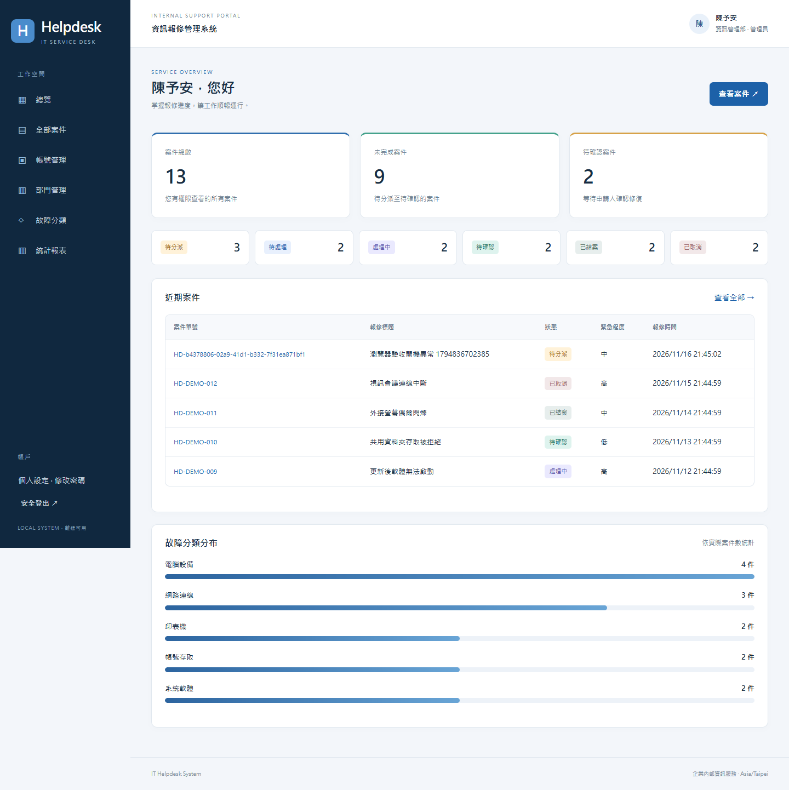
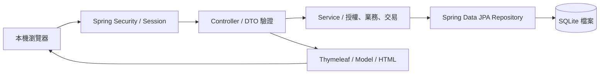
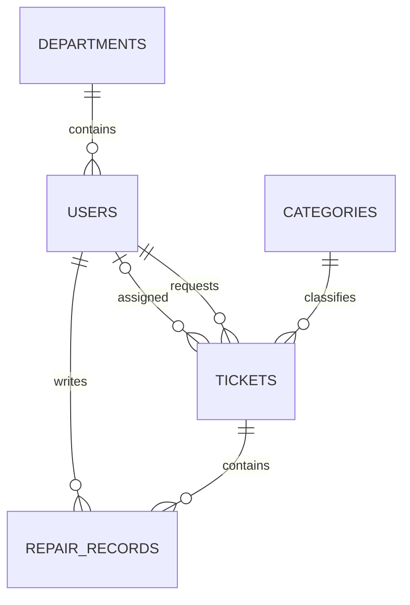

# IT Helpdesk System｜資訊報修管理系統

以 Java 21、Spring Boot 3.5.14、Thymeleaf SSR 與 SQLite 開發的繁體中文本機 Web 系統，模擬企業員工報修、管理員分派、工程師維修及員工驗收。
規格：[SPEC.md](SPEC.md)、[DESIGN.md](DESIGN.md)、[AGENTS.md](AGENTS.md)。階段實作與教學見 [DEVELOPMENT.md](docs/DEVELOPMENT.md)，驗收對照見 [ACCEPTANCE.md](docs/ACCEPTANCE.md)。

八階段已完成，最終 **36 項 Maven 測試全部成功**，jar 的隔離環境瀏覽器操作與實際重啟驗收通過。完整結果見 [TEST-RESULTS.md](docs/TEST-RESULTS.md)。

2026-11-17 已完成不改變功能的格式整理，36 項測試與 21 頁介面比對通過。新的 JAR 為 `target/it-helpdesk-system-1.0.0-formatted.jar`；此次保留執行中的原 JAR，建置方式與報告見 [FORMAT-REVIEW.md](docs/FORMAT-REVIEW.md)。



## 環境與固定版本

| 項目 | 版本／方式 |
|---|---|
| JDK | Java 21；本機驗證 Oracle JDK 21.0.11 |
| Spring Boot Parent | 3.5.14 |
| Maven / Wrapper | 3.9.16 / 3.3.4，only-script |
| Hibernate Core / community dialect | 6.6.49.Final，Parent 管理 |
| SQLite JDBC | 3.49.1.0，Parent 管理，隨 jar 包含原生驅動 |
| 前端 | Thymeleaf、Bootstrap 5.3.9、本機 CSS/JS、系統字型 |
| 認證 | Spring Security、HTTP Session、BCrypt、CSRF |
| 測試 | JUnit 5、Spring Boot Test、MockMvc、Security Test、真實 SQLite 暫存檔 |

Spring starters 與受 Parent 管理依賴不另指定 version；不使用 Lombok。Bootstrap 授權位於 `src/main/resources/static/vendor/bootstrap/LICENSE`。
不需另外安裝 SQLite、Node.js 或前端建置工具來執行應用程式。

## 快速開始（Windows PowerShell）

先確認 `java -version` 與 `javac -version` 都是 21。若同時安裝多個 JDK，可在目前 PowerShell 設定 `$env:JAVA_HOME` 指向自己的 JDK 21；不必更改系統設定。

```powershell
cd D:\it-helpdesk-system
.\mvnw.cmd -v
.\mvnw.cmd clean verify
java -jar target/it-helpdesk-system-1.0.0.jar --spring.profiles.active=demo --helpdesk.database=data/demo-helpdesk.db
```

開啟 **http://127.0.0.1:8080**。根路徑會導向首頁；未登入者先進入登入頁。停止服務使用 `Ctrl+C`。

首次 Maven 執行需要網路下載固定 Maven 與依賴；Wrapper 快取預設 `.tools/maven-home`，repository 為 `.tools/repository`，均在專案內且受 Git 忽略。已打包的 jar 僅需 JDK 21，可離線執行；不需要 Maven 快取。

開發時亦可直接執行：

```powershell
.\mvnw.cmd spring-boot:run '-Dspring-boot.run.profiles=demo' '-Dspring-boot.run.arguments=--helpdesk.database=data/demo-helpdesk.db'
```

Linux/macOS 改用 `./mvnw`（必要時先執行 `chmod +x mvnw`）。jar 的啟動參數相同。

## 展示帳號

只有明確指定 `--spring.profiles.active=demo` 時才初始化虛構展示資料。以下全部是公開展示帳密，**不可用於正式環境**。

| 帳號 | 密碼 | 角色 | 虛構姓名 |
|---|---|---|---|
| `admin` | `Demo1234!` | 管理員 | 陳予安 |
| `engineer` | `Demo1234!` | 工程師 | 林承宇 |
| `employee` | `Demo1234!` | 員工 | 王思涵 |
| `engineer2` | `Demo1234!` | 第二位工程師 | 吳柏辰 |
| `employee2` | `Demo1234!` | 第二位員工 | 李佳穎 |

初次建立四個部門、五種分類、五個帳號、十二件涵蓋六種狀態的案件及五筆維修紀錄。密碼在資料庫中只存 BCrypt 雜湊。
初始化在同一交易完成；再次啟動保留現有資料，不重複建立或重設密碼。若指定的資料庫已有其他資料，會拒絕混入展示資料；請改指定新的資料檔路徑，勿刪除既有資料。

## 非 demo 首次管理員

不使用 demo profile 時，不會建立公開展示帳號。空資料庫首次啟動需要用環境變數提供管理員帳號與密碼：

```powershell
$env:HELPDESK_ADMIN_USERNAME = 'local_admin'
$env:HELPDESK_ADMIN_PASSWORD = [System.Net.NetworkCredential]::new('', (Read-Host '首次管理員密碼（至少 8 字元，最多 72 UTF-8 位元組）' -AsSecureString)).Password
java -jar target/it-helpdesk-system-1.0.0.jar
```

預設資料檔為 `data/helpdesk.db`。已有帳號時不再初始化，環境變數也不會重設帳密。使用完畢可關閉該 PowerShell，或在停止應用後清除 `HELPDESK_ADMIN_PASSWORD` 環境變數。勿把個人密碼寫入 README、命令歷史、Git 或 properties。

## 功能與操作演示

1. **員工**：以 `employee` 登入 → 新增報修，填寫標題、啟用分類、位置、緊急程度及描述 → 記下單號；初始為「待分派」。
2. **管理員**：以 `admin` 登入 → 全部案件 → 案件詳情 → 指定 `林承宇`，變為「待處理」。帳號列表亦可直接查看工程師負責案件。
3. **工程師**：以 `engineer` 登入 → 我的維修 → 開始維修 → 填寫故障原因、處理方式與維修結果 → 提交完成，變為「待確認」。
4. **員工**：首頁會顯示待確認提示；進入案件可確認修復結案，或填寫退回原因。退回後工程師再提交會新增紀錄，保留前次歷史。
5. **取消與重新分派**：員工只可取消自己的待分派案件；管理員只可重新分派待處理或處理中案件。終態案件不可再修改。
6. **管理功能**：管理員可新增修改啟停帳號、部門與分類，查看部門員工及分類統計；被引用資料保留。不得移除最後有效管理員權限；工程師有未完成案件時不能停用或變更角色。
7. **查詢**：依標題／單號、狀態、分類、報修日期區間篩選。預設每頁 10 筆，以報修時間及 ID 遞減排列。日期含首尾日，使用 Asia/Taipei 解讀。
8. **個人設定**：驗證舊密碼後修改密碼；成功後重新登入。所有角色都可安全登出。

員工僅能查看自己提出的案件；工程師案件列表及操作只限目前分派案件。本人維修紀錄頁可唯讀查看自己曾撰寫的紀錄，轉派後不取得該案操作權。管理員可看全部案件，但不能代替員工驗收或工程師維修。

## 架構與資料流



| 類別／目錄 | 職責與修改位置 |
|---|---|
| `controller/` | 路由、表單 BindingResult、Model、成功後 redirect；不直接存取 Repository |
| `CurrentUserService` / `LiveAccountFilter` | 讀取目前帳號並核對最新啟用及角色，撤銷舊 Session 權限 |
| `DirectoryService` | 帳號、部門、分類管理及歷史資料保護 |
| `TicketService` | 報修、角色範圍查詢、分頁、展示 DTO |
| `TicketWorkflowService` | 狀態機、所有權、表單版本檢查與同一交易寫入維修歷史 |
| `DashboardService` | 真實資料的角色統計、近期案件及管理員分類統計 |
| `repository/` / `entity/` | 查詢與資料表映射；Entity 提供必要無參數建構子 |
| `dto/` / `enums/` | 表單及展示資料、Jakarta Validation、固定角色／狀態／優先級 |
| `DatabaseConfig` / `InstantTextConverter` | 單連線池、每連線外鍵、5 秒 busy timeout、固定格式 UTC TEXT |
| `templates/` / `static/` | SSR 頁面與共用 fragments、本機樣式／腳本 |

寫入由 Service `@Transactional` 控制。案件操作同時比對表單版本及 Entity `@Version`，拒絕過期或重複提交；錯誤時整筆交易 rollback。Enum 使用 STRING 儲存，時間為固定九位小數的 ISO-8601 UTC TEXT，顯示轉為台北時間。

## 目錄

```text
pom.xml / mvnw / mvnw.cmd / .mvn/   建置及固定 Wrapper
SPEC.md / DESIGN.md / AGENTS.md     原始規格
src/main/java/com/helpdesk/
  HelpdeskApplication.java
  controller/ service/ repository/ entity/
  dto/ enums/ config/ exception/
src/main/resources/
  application.properties / application-demo.properties
  schema.sql
  templates/auth/ dashboard/ tickets/ admin/ error/ fragments/
  static/css/ vendor/bootstrap/
src/test/java/com/helpdesk/         整合、安全、查詢、交易、展示資料測試
scripts/                           選用的瀏覽器及網路隔離驗收工具
docs/                              教學、驗收與開發紀錄
data/                              執行資料，受 Git 忽略
target/                            jar、測試報告與測試資料，受 Git 忽略
.tools/                            本機工具、快取與驗收產物，受 Git 忽略
```

## 資料庫 ERD 與保留規則



五張核心資料表為 departments、users、categories、tickets、repair_records。由 `schema.sql` 的 `CREATE TABLE/INDEX IF NOT EXISTS` 建立；`ddl-auto=none`，Hibernate 不修改或重建資料庫。
外鍵皆 RESTRICT；啟停資料替代刪除。`tickets.version` 處理樂觀鎖，`return_reason` 保留最近退回原因；維修紀錄逐次新增。完整欄位見 DESIGN.md。
單號使用 `HD-` + UUID；只有固定的虛構 demo 案件採可辨認的展示單號。

所有變更採 POST + CSRF token，成功後 PRG；Thymeleaf 預設跳脫輸出，查詢參數綁定。展示 DTO 不含密碼雜湊，403／404／表單／資料衝突提供中文提示。

預設只監聽 `127.0.0.1:8080`。可用 `HELPDESK_DATABASE` 或 `--helpdesk.database=...` 指定資料檔。重啟保留資料；備份時先停止應用，再複製資料檔。勿把 `.db`、快取、秘密或本機設定提交 Git。

## 測試、打包與離線驗收

```powershell
.\mvnw.cmd test
.\mvnw.cmd clean verify
.\mvnw.cmd help:effective-pom '-Doutput=target/effective-pom.xml'
.\mvnw.cmd dependency:tree '-DoutputFile=target/dependency-tree.txt'
```

測試資料庫為 `target/test-databases/` 內的獨立 SQLite 暫存檔，不使用或清空展示資料庫。
JUnit XML／文字報告位於 `target/surefire-reports/`。交易測試逐次 HTTP 請求實際 commit，使用 SQLite trigger 故意使維修紀錄插入失敗，驗證狀態與版本 rollback。

打包結果：`target/it-helpdesk-system-1.0.0.jar`。離線操作可在網路中斷後直接執行前述 `java -jar` 命令；所有樣式、JS 與字型均不依賴外網。

本機額外自動驗收使用 `scripts/offline.policy` 阻擋 Java 程序非 loopback socket，並在 Chrome 中封鎖非本機頁面請求；不更動整台電腦網路。此政策只用於 Java 21 的測試程序，會出現 JDK Security Manager 淘汰警告，正常啟動不需帶入這些旗標。驗收範圍與實際結果見 [ACCEPTANCE.md](docs/ACCEPTANCE.md)。

瀏覽器驗收工具是選用開發工具，需要 Node.js、Chrome 及專案內 Playwright，應用程式本身不依賴它們：

```powershell
npm.cmd install --prefix .tools/browser --cache .tools/npm-cache --no-audit --no-fund --save-exact playwright@1.58.2
# 先以獨立資料庫在本機 18080 啟動 jar；測試會新增虛構案件及帳號。
node scripts/browser-acceptance.cjs
# 自動建立獨立測試資料庫，啟動隔離 jar、操作瀏覽器並重啟驗證：
powershell -NoProfile -File scripts/verify-offline.ps1
```

預設瀏覽器為 Windows Chrome；可用 `BROWSER_PATH` 指定其他 Chromium 執行檔，`HELPDESK_TEST_URL` 指定測試網址。截圖與 JSON 結果輸出到 `.tools/acceptance/`。

## 範圍

本版依規格維持單機 SSR，未加入圖片上傳、CSV、外部通知、雲端服務、自動派單、公開註冊、完整時間軸或 SPA。所有展示人物與案件皆為虛構。
## 版本紀錄

- v1.0：完成資訊報修管理系統初始版本。